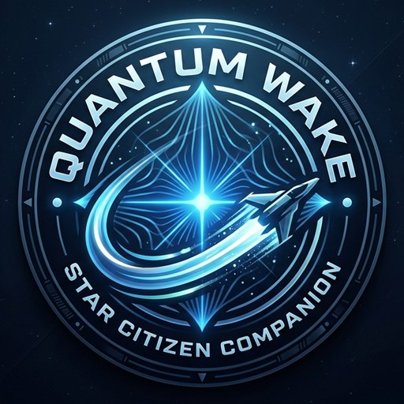
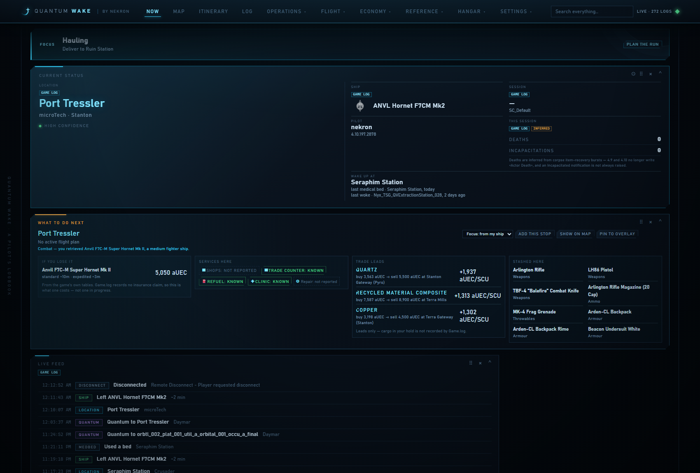
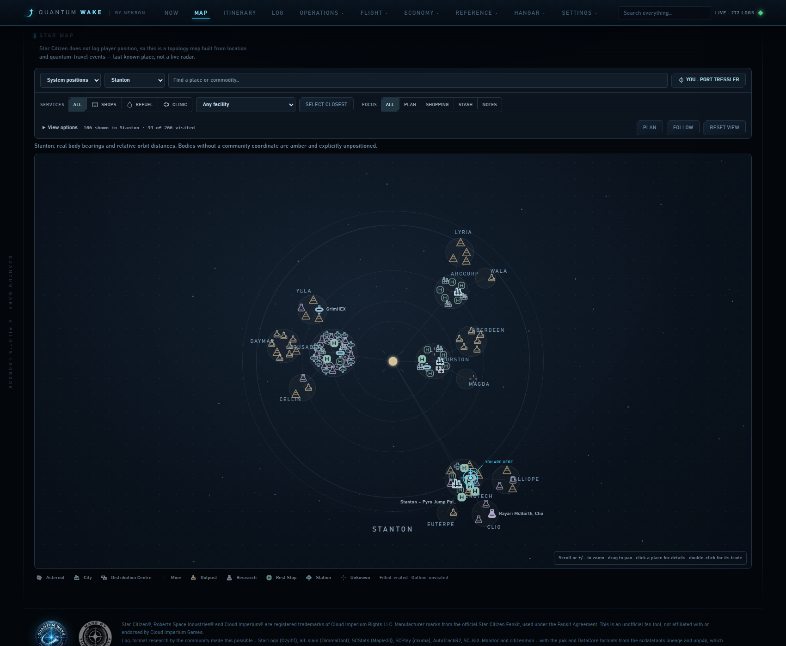
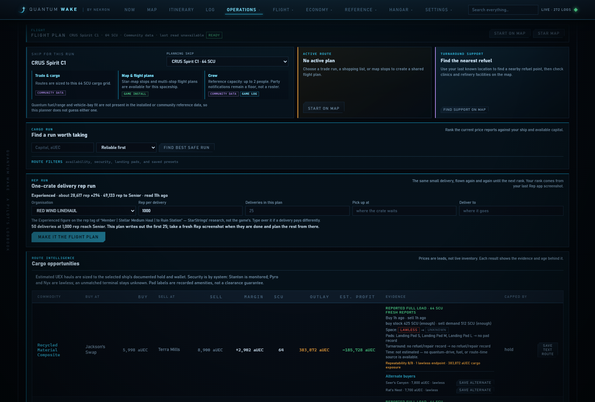

# Quantum Wake

**A private Star Citizen logbook for Windows.**

Quantum Wake reads the logs Star Citizen already writes and turns them into a
personal record of your flights: where you went, what you flew, contracts,
trades, ships, gear and the things you choose to plan next. It runs on your PC;
there is no account and no required online service.

[](https://github.com/peans99/QuantumWake/actions/workflows/ci.yml)


> **Your game, your data.** Quantum Wake reads your logs and game files locally.
> Network features such as current market prices are off until you turn them on.

## See it in use

<table>
  <tr>
    <td width="33%"><a href="docs/images/now.png"></a><br><sub><b>Now</b><br>Start with the last known location, ship, wake-up point and this session.</sub></td>
    <td width="33%"><a href="docs/images/map.png"></a><br><sub><b>Map</b><br>Find places you have visited and nearby refuel, repair or clinic services.</sub></td>
    <td width="33%"><a href="docs/images/routes.png"></a><br><sub><b>Routes</b><br>Keep a flight plan, cargo run or next stop in view.</sub></td>
  </tr>
</table>

The dashboard is for planning and history. The optional overlay gives the same
short answers over the game, and the optional Cougar MFD mode keeps navigation,
tasks and cargo close to the cockpit.

## Start here

### 1. Download and run

**[Download QuantumWake.exe](https://github.com/peans99/QuantumWake/releases/latest)**,
move it somewhere you keep applications, then open it. There is no installer,
account or separate .NET download.

Quantum Wake starts in the notification area. Right-click its tray icon to open
the dashboard or overlay. The dashboard is also available at
<http://127.0.0.1:31337> while the app is running.

<details>
<summary>Windows shows an unknown-publisher warning</summary>

The executable is not code-signed. If you downloaded it from the release page
above, choose <b>More info → Run anyway</b>. Every release is scanned by
Microsoft Defender during the release build; that is a malware scan of the
published files, not a publisher identity check.
</details>

### 2. Let it read your history

Quantum Wake finds LIVE, PTU and EPTU installations on fixed drives. On first
start it reads `Game.log` and its backups, then watches only the current log as
you play. A large log history can take a few minutes; the app shows the reading
progress.

If your installation is in an unusual location, run:

```powershell
QuantumWake.exe --path "D:\...\StarCitizen\LIVE"
```

### 3. Pick the view you need

| When you want to… | Open… |
|---|---|
| Check your last location, ship or wake-up point | **Now** |
| Find a station, city, outpost or nearby service | **Map** |
| Review a flight, session, place or server | **Logbook** |
| Plan a route, cargo run, checklist or event | **Command Deck** |
| Look up ships, parts, mining, crafting or gear | **Hangar** and **Reference** |
| Keep a small answer visible in Star Citizen | **Overlay** |

## Optional extras

### Overlay

The overlay starts off. Star Citizen needs **Borderless Windowed** mode for it
to sit above the game. Use the tray icon or `Ctrl+Alt+O` to show it. Its pin
button makes it click-through; `Ctrl+Alt+←/→` changes page and `Ctrl+Alt+F`
expands it.

### Cockpit HUD

If you use paired Cougar MFDs, Quantum Wake can show navigation, tasks, cargo,
contracts, money and the live feed on them. Read the [Cockpit HUD guide](docs/mfd-mode.md)
when you are ready to set it up.

### Screenshots and copied locations

You can ask Quantum Wake to read a saved Star Citizen screenshot or a copied
`/showlocation` result. This can add facts the log does not carry, such as a
kiosk balance or fitted ship parts. It reads the saved file locally; it never
captures your screen or reads game memory.

## What Quantum Wake reads

| Source | What it can add |
|---|---|
| **Your logs** | Sessions, travel, ships, contracts, party activity, inventory sightings and confirmed transactions. |
| **Your game install** | Names, items, commodities, recipes, mining deposits, place descriptions and facilities. |
| **Saved screenshots or copied locations** | Optional dated readings when you explicitly ask for them. |
| **Optional community services** | Current prices, shop listings, ship details and wider map/mining coverage. |

The data database lives in `%LOCALAPPDATA%\Quantumwake`. Nothing is written
inside Star Citizen unless you explicitly install **item labels** or
**StarStrings**. Both make a backup before replacing the game's English text
file.

## A few useful limits

- It is a logbook, not a live position tracker. Locations come from arrivals,
  inventory and quantum-travel records, and say when they are inferred.
- Current Star Citizen logs do not provide a complete killboard, automatic mining
  history or a complete wallet history. The app labels estimates and partial
  totals instead of filling gaps with zeroes.
- Crew and event totals are floors: players or contracts without the necessary
  log entries cannot be counted.


## Updates, removal and help

The tray icon checks for updates when you ask it to, downloads a new build and
restarts the app. Some updates re-read your history; release notes call that out.

To remove Quantum Wake, delete `QuantumWake.exe` and
`%LOCALAPPDATA%\Quantumwake`. Remove item labels from the app first if you
installed them.

**Settings → Report a problem** makes a small diagnostic file. It contains
parser counts, game builds and integration state, but not logs, account
identifiers, handles, folder names or API keys. You can inspect it before
attaching it to an issue.

## For contributors

The app runs on Windows 10 or 11. WebView2 is required for the overlay and is
included with Windows 11; Windows 10 users can install it from
[Microsoft](https://developer.microsoft.com/microsoft-edge/webview2/).

<details>
<summary>Build and test from source</summary>

```powershell
.\start.ps1                     # tray icon, dashboard and overlay
.\start.ps1 -NoOverlay          # server only
.\start.ps1 -Lan                # allow another device on the network
.\start.ps1 -Rescan             # rebuild the log cache
.\start.ps1 -Path "D:\...\StarCitizen\LIVE"

dotnet test Quantumwake.slnx -c Release
```

The [.NET 10 SDK](https://dotnet.microsoft.com/download) is only needed to build
from source. The command-line parser can export newline-delimited JSON with
`dotnet run --project src\Quantumwake.Cli -c Release -- --events`.

See [all documentation](docs/README.md) for the game-data reader, log format,
architecture, screen reading, simulator, data sources and release process.
</details>

## Licence and credits

The code is licensed under [Apache 2.0](LICENSE). The name and logo are not
licensed. Manufacturer artwork comes from the official Star Citizen Fankit and
has separate terms; see [NOTICE](NOTICE) before redistributing it.

Quantum Wake builds on community knowledge and tools from StarLogs, all-slain,
SCStats, SCPlay, scdatatools, unp4k and others. StarStrings is made by MrKraken.
The complete attribution list is in [docs/credits.md](docs/credits.md).

Star Citizen®, Roberts Space Industries® and Cloud Imperium® are registered
trademarks of Cloud Imperium Rights LLC. Quantum Wake is an unofficial fan
project and is not affiliated with or endorsed by Cloud Imperium Games.

## Release notes

### 0.18.11

**More of Quantum Wake is now in French.** With Français chosen under Settings → General, French now covers the Reference pages (Ships, Parts, Mining and Crafting), the Map, the Log and the Economy pages (Spending, Ledger, Cargo, Market and each commodity's full picture), alongside the Flight pages: Logbook, Sessions, Servers, Places, Points, Crew and Casualties. That covers both the browser and the overlay. On the map, French reaches the toolbar, the hover tips, a place's card, the flight-plan panel and the run review. On the Log, it reaches what each screenshot read and the list of game logs. On Mining, it covers all four panes: where to go, the rock calculator with its verdict and fit, your hauls and refinery orders with their reminders, and salvage. Item cards opened from any page are French too. Names stay as the game writes them: ships, places, commodities, minerals, items, blueprints, careers, terminals, shops, shard IDs and the handles of the people you flew with. So do the names and notes you wrote yourself. A copied server report stays in English, because it is meant to be pasted where other pilots will read it. Some English remains: the text read off a screenshot is quoted as the game printed it, and a few lines the app's server writes (checks on a reading, the rock calculator's notes) come later. Hangar, the rest of Settings and Help are still English for now.

**Two English labels are worded more precisely.** On Servers, a stay you ended yourself now reads "you left". On Crew, the column counting a member's connection dropping is now "Went offline", next to "Came online". The old words also appear on other pages with a different meaning (somebody leaving your party, a contract you dropped), and a translation could only pick one of them.
