# Quantum Wake

**A private Star Citizen logbook for Windows.**

Quantum Wake reads the logs Star Citizen already writes and turns them into a
personal record of your flights: where you went, what you flew, contracts,
trades, ships, gear and the things you choose to plan next. It runs on your PC;
there is no account and no required online service.

[](https://github.com/peans99/QuantumWake/actions/workflows/ci.yml)


> **Your game, your data.** Quantum Wake reads your logs and game files locally.
> Network features such as current market prices are off until you turn them on.

## See it in use

<table>
  <tr>
    <td width="33%"><a href="docs/images/now.png"></a><br><sub><b>Now</b><br>Start with the last known location, ship, wake-up point and this session.</sub></td>
    <td width="33%"><a href="docs/images/map.png"></a><br><sub><b>Map</b><br>Find places you have visited and nearby refuel, repair or clinic services.</sub></td>
    <td width="33%"><a href="docs/images/itinerary.png">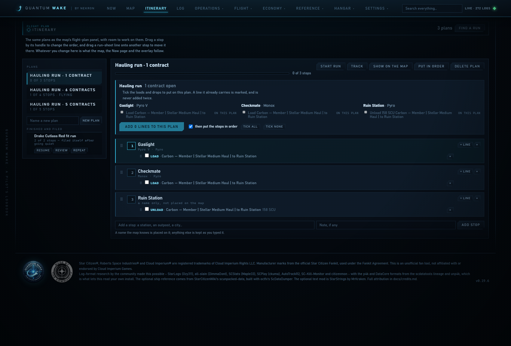</a><br><sub><b>Itinerary</b><br>Lay out a flight plan stop by stop, and merge a hauling run into it.</sub></td>
  </tr>
</table>

<details>
<summary>More pages</summary>

<table>
  <tr>
    <td width="33%"><a href="docs/images/operations.png">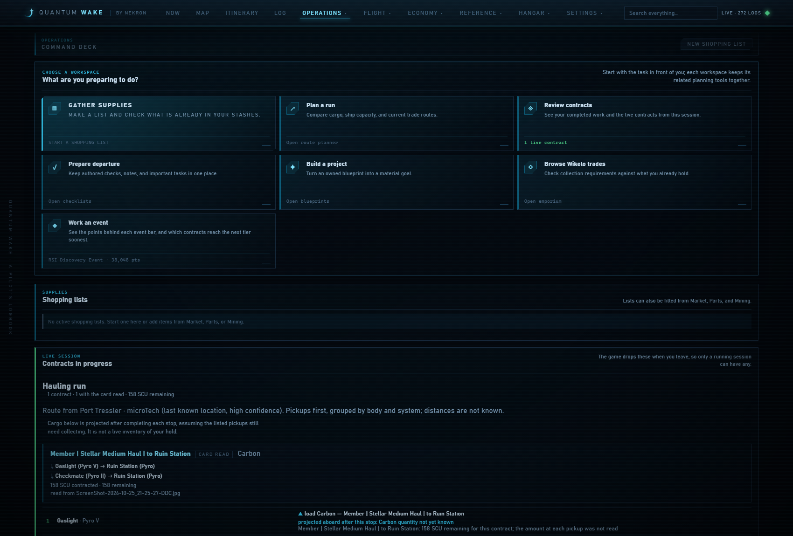</a><br><sub><b>Command deck</b><br>Shopping lists, checklists, projects and the contracts open in this session.</sub></td>
    <td width="33%"><a href="docs/images/routes.png"></a><br><sub><b>Routes</b><br>Find a cargo run sized to your ship, or a rep run to the next rank.</sub></td>
    <td width="33%"><a href="docs/images/reputation.png">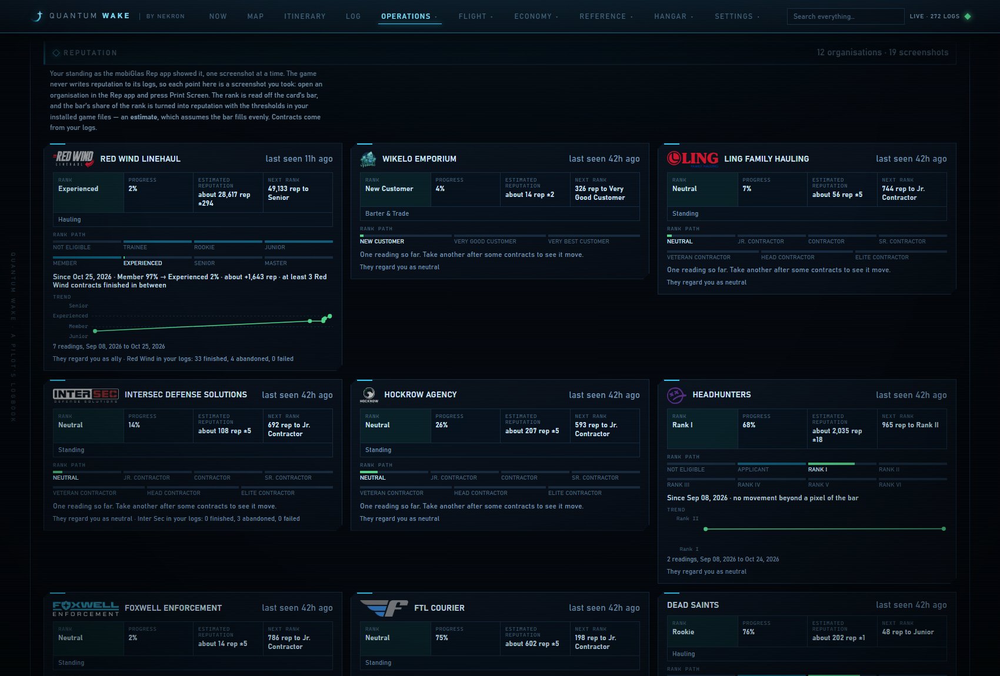</a><br><sub><b>Reputation</b><br>Your rank with each organisation, read from Rep app screenshots.</sub></td>
  </tr>
  <tr>
    <td><a href="docs/images/events.png">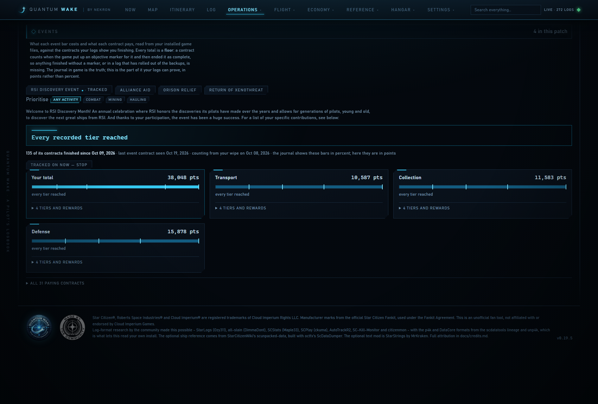</a><br><sub><b>Events</b><br>The points behind each event bar, counted from contracts you finished.</sub></td>
    <td><a href="docs/images/logbook.png">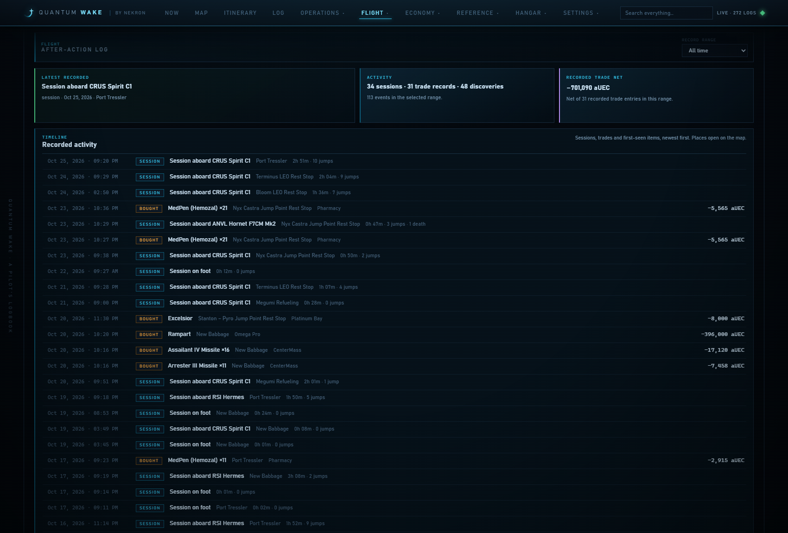</a><br><sub><b>Logbook</b><br>Sessions, purchases and discoveries, newest first.</sub></td>
    <td><a href="docs/images/sessions.png">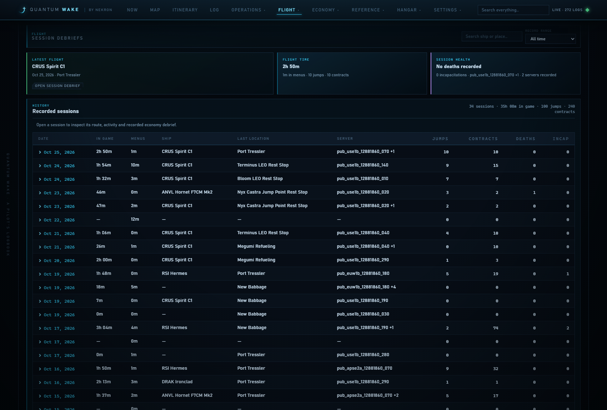</a><br><sub><b>Sessions</b><br>Every session with its ship, time, jumps, contracts and server.</sub></td>
  </tr>
  <tr>
    <td><a href="docs/images/ledger.png">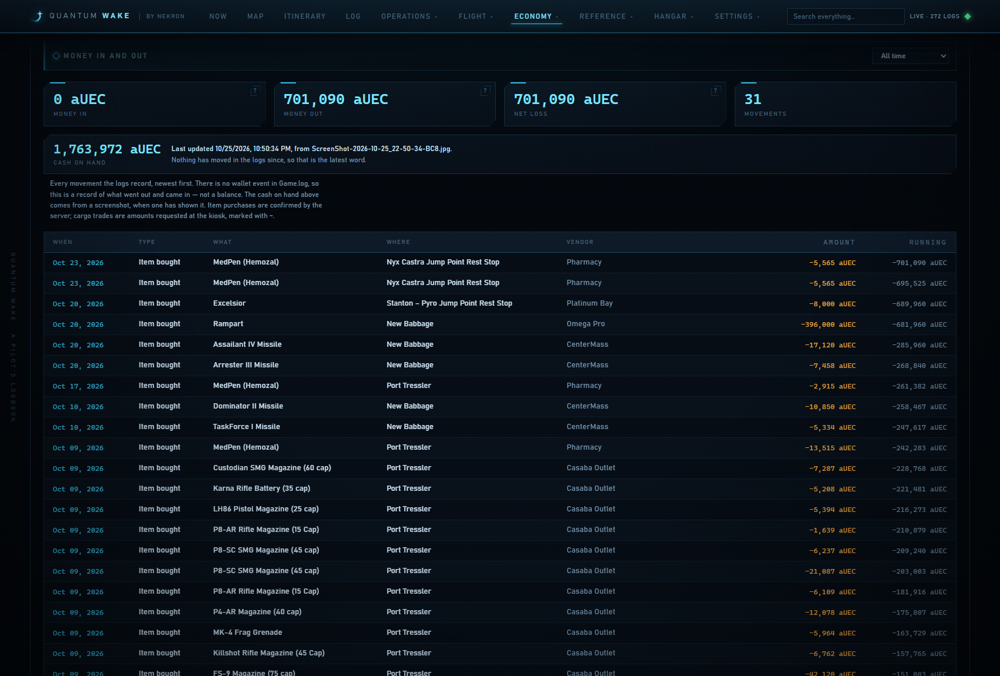</a><br><sub><b>Ledger</b><br>Money in and out as the logs record it, with cash on hand from a screenshot.</sub></td>
    <td><a href="docs/images/market.png">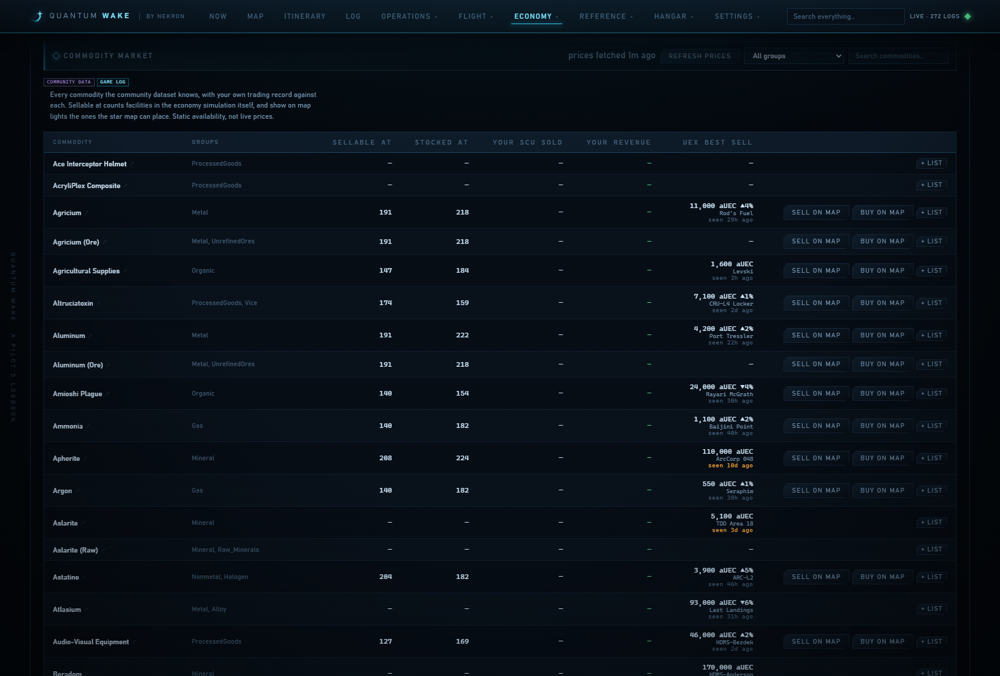</a><br><sub><b>Market</b><br>Every commodity, where it sells, and your own trading against it.</sub></td>
    <td><a href="docs/images/fleet.png">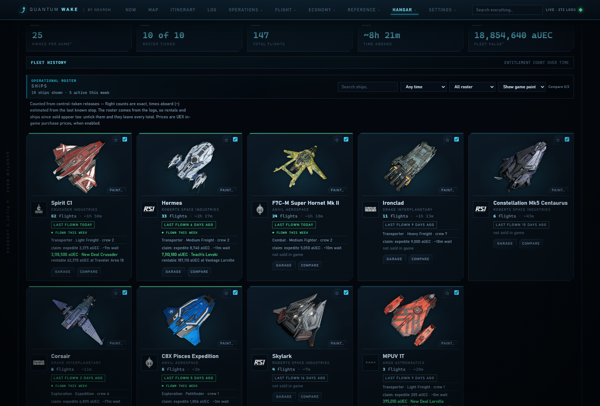</a><br><sub><b>Fleet</b><br>The ships you fly, with flight counts, claim times and prices.</sub></td>
  </tr>
  <tr>
    <td><a href="docs/images/garage.png">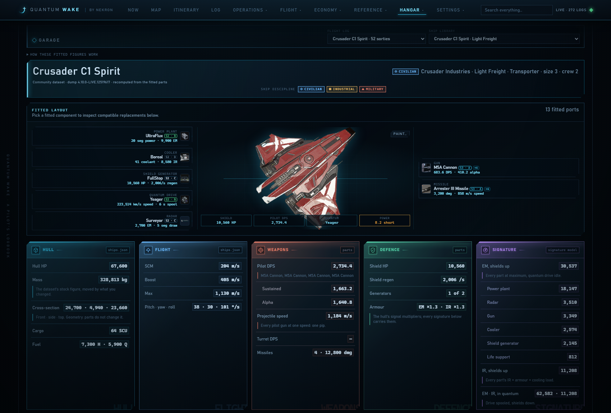</a><br><sub><b>Garage</b><br>A ship's fitted parts and the figures they add up to.</sub></td>
    <td><a href="docs/images/armoury.png">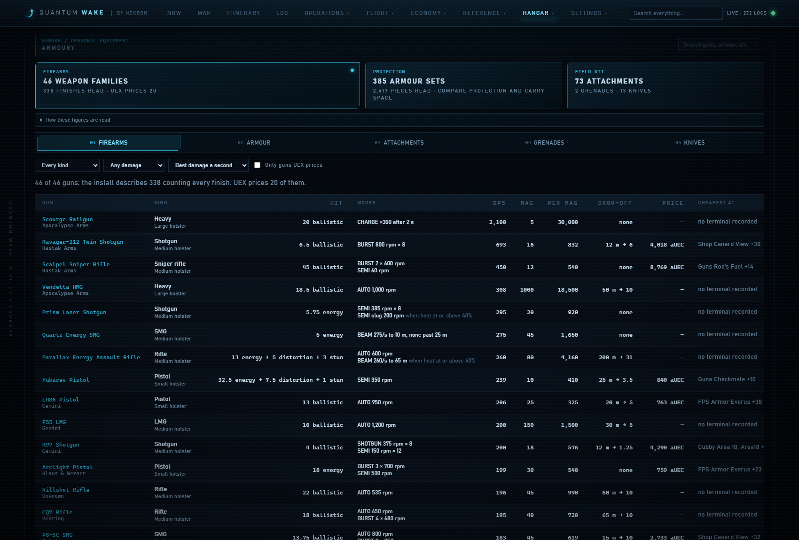</a><br><sub><b>Armoury</b><br>Guns, armour and attachments from your installed game files.</sub></td>
    <td></td>
  </tr>
</table>
</details>

The dashboard is for planning and history. The optional overlay gives the same
short answers over the game, and the optional Cougar MFD mode keeps navigation,
tasks and cargo close to the cockpit. The dashboard, overlay and MFD pages are
in English or French; choose under **Settings → General**.

## Start here

### 1. Download and run

**[Download QuantumWake.exe](https://github.com/peans99/QuantumWake/releases/latest)**,
move it somewhere you keep applications, then open it. There is no installer,
account or separate .NET download.

Quantum Wake starts in the notification area. Right-click its tray icon to open
the dashboard or overlay. The dashboard is also available at
<http://127.0.0.1:31337> while the app is running.

On Linux there is a separate download and no tray icon; see [Linux](#linux)
below.

<details>
<summary>Windows shows an unknown-publisher warning</summary>

The executable is not code-signed. If you downloaded it from the release page
above, choose <b>More info → Run anyway</b>. Every release is scanned by
Microsoft Defender during the release build; that is a malware scan of the
published files, not a publisher identity check.
</details>

### 2. Let it read your history

Quantum Wake finds LIVE, PTU and EPTU installations on fixed drives. On first
start it reads `Game.log` and its backups, then watches only the current log as
you play. A large log history can take a few minutes; the app shows the reading
progress.

If your installation is in an unusual location, run:

```powershell
QuantumWake.exe --path "D:\...\StarCitizen\LIVE"
```

### 3. Pick the view you need

| When you want to… | Open… |
|---|---|
| Check your last location, ship or wake-up point | **Now** |
| Find a station, city, outpost or nearby service | **Map** |
| Lay out a flight plan, or merge a hauling run into one | **Itinerary** |
| Read the live feed, or a screenshot you just took | **Log** |
| Find a cargo or rep run, follow contracts, reputation or an event | **Operations** |
| Review a flight, session, place or server | **Flight** |
| Follow money in and out, or commodity prices | **Economy** |
| Look up ships, parts, mining or crafting | **Reference** |
| See your ships, fittings, stash and gear | **Hangar** |
| Keep a small answer visible in Star Citizen | **Overlay** |

## Optional extras

### Overlay

The overlay starts off. Star Citizen needs **Borderless Windowed** mode for it
to sit above the game. Use the tray icon or `Ctrl+Alt+O` to show it. Its pin
button makes it click-through; `Ctrl+Alt+←/→` changes page, `Ctrl+Alt+F`
expands it and `Ctrl+Alt+C` switches to a small glance view.

### Cockpit HUD

If you use paired Cougar MFDs, Quantum Wake can show navigation, tasks, cargo,
contracts, money and the live feed on them. Read the [Cockpit HUD guide](docs/mfd-mode.md)
when you are ready to set it up; `Ctrl+Alt+M` opens MFD setup from anywhere.

### Screenshots and copied locations

You can ask Quantum Wake to read a saved Star Citizen screenshot or a copied
`/showlocation` result. This can add facts the log does not carry, such as a
kiosk balance, fitted ship parts, your rank with an organisation in the Rep
app, or the pickups and SCU on a hauling contract in the Contracts app. It reads
the saved file locally; it never captures your screen or reads game memory.

## Linux

Quantum Wake runs on Linux for pilots who play Star Citizen under Wine or
Proton. The dashboard, the log and game-data readers, screenshots and copied
locations all work there. The overlay, the cockpit HUD and joystick input stay
on Windows: all three are built on Windows desktop components, and they are
not what a Linux pilot is missing.

### Before you start

- **A working Star Citizen install under Wine.** Quantum Wake reads the game's
  own files, so the game has to be installed and started at least once. The
  Linux Users Group is the reference for that: its
  [LUG Helper](https://github.com/starcitizen-lug/lug-helper) installs the
  game, and its wiki's
  [recommended distributions](https://wiki.starcitizen-lug.org/Tips-and-Tricks#recommended-distros)
  are Fedora, Arch, EndeavourOS, openSUSE Tumbleweed, Bazzite, the latest
  Ubuntu release, Debian Testing and Gentoo; it advises against LTS releases
  such as Debian Stable, Ubuntu LTS, Mint, Pop!_OS, Zorin, openSUSE Leap and
  Manjaro. Its preflight check raises `vm.max_map_count` to 16777216 and the
  open-file hard limit to 524288, which the game needs and Quantum Wake does
  not touch. Quantum Wake was built and measured against an install the LUG
  Helper made on Fedora 44.
- **An x86-64 distribution with glibc 2.27 or later**, which is every
  distribution above. The Linux download carries its own copy of .NET, so
  nothing is installed for the dashboard; it needs `libicu` (the dashboard's
  French and date formats come from it) and `libstdc++` (the screenshot
  reader), both present on a desktop install. Microsoft lists Fedora 43 and
  44, Ubuntu 22.04 to 26.04, Debian 13, openSUSE Leap 16 and RHEL 8 to 10 as
  [supported by .NET 10](https://github.com/dotnet/core/blob/main/release-notes/10.0/supported-os.md);
  Arch is not on the list and runs it.
- **For copied `/showlocation` results:** `wl-clipboard` on Wayland (Fedora KDE
  ships it as `wl-paste`), or `xclip` or `xsel` on X11. Without one the
  dashboard says the clipboard cannot be read; screenshots still can.
- **The command-line tool** in the same archive is not self-contained: it needs
  the .NET 10 runtime (`dotnet-runtime-10.0` on Fedora and Ubuntu). The
  dashboard does not.

### Start

Download `QuantumWake-<version>-linux-x64.tar.gz` from the
[release page](https://github.com/peans99/QuantumWake/releases/latest), then:

```bash
tar xzf QuantumWake-*-linux-x64.tar.gz
cd QuantumWake
./quantumwake
```

Open <http://127.0.0.1:31337> once the terminal prints `Now listening on` and
`Application started. Press Ctrl+C to shut down`. Nothing opens a browser for
you and there is no tray icon. It finds the game inside the Wine prefix on its
own: a LUG Helper install is read from the helper's settings, and otherwise it
looks in `$WINEPREFIX`, `~/Games`, `~/.wine`, Steam's Proton prefixes, Bottles
and Heroic. If it comes up empty, the dashboard says which prefixes it searched
and asks for the folder, which can be the prefix itself, the `LIVE` folder
under its `drive_c`, or the `C:\...` path copied from the RSI launcher.

```bash
./quantumwake --path ~/Games/star-citizen     # the prefix, or .../StarCitizen/LIVE
./quantumwake --Port 31395                    # another port
./quantumwake --Lan true                      # reachable from another device
```

Its data lives in `~/.local/share/Quantumwake` (or under `$XDG_DATA_HOME`), and
the .NET host unpacks its native libraries to `~/.net/quantumwake/` (42 MB) on
the first start. The first time you switch screenshot reading on it fetches
the two text-recognition models (14 MB) into that data folder.

On the machine this was built on, a Fedora 44 virtual machine, the start took
anywhere from 2 to 90 seconds before the ready line, all of it inside .NET's
own host start-up: an empty ASP.NET application shows the same spread there.
Wait for the ready line rather than reloading the page.

### Stop

`Ctrl+C` in the terminal stops it, within two seconds in every measurement;
closing the terminal stops it too. From anywhere else, `pkill quantumwake`. A
second `./quantumwake` while one is running prints
`Quantum Wake is already running at http://127.0.0.1:31337` and exits.

To have it start with your session and run in the background, a systemd user
service does it:

```bash
mkdir -p ~/.config/systemd/user
cat > ~/.config/systemd/user/quantumwake.service <<'EOF'
[Unit]
Description=Quantum Wake dashboard

[Service]
ExecStart=%h/QuantumWake/quantumwake
Restart=on-failure

[Install]
WantedBy=default.target
EOF
systemctl --user enable --now quantumwake      # start now and at every login
systemctl --user stop quantumwake              # stop; journalctl --user -u quantumwake shows its log
```

Adjust `ExecStart` to wherever you unpacked it.

### Update and remove

The dashboard still checks for new versions and tells you, but it does not
replace itself on Linux; unpack the new archive over the old folder. To remove
Quantum Wake, delete the unpacked folder, `~/.local/share/Quantumwake` and
`~/.net/quantumwake`, and disable the user service if you created one.


## What Quantum Wake reads

| Source | What it can add |
|---|---|
| **Your logs** | Sessions, travel, ships, contracts, party activity, inventory sightings and confirmed transactions. |
| **Your game install** | Names, items, commodities, recipes, mining deposits, place descriptions and facilities. |
| **Saved screenshots or copied locations** | Optional dated readings when you explicitly ask for them. |
| **Optional community services** | Current prices, shop listings, ship details and wider map/mining coverage. |

The data database lives in `%LOCALAPPDATA%\Quantumwake`. Nothing is written
inside Star Citizen unless you explicitly install **item labels** or
**StarStrings**. Both make a backup before replacing the game's English text
file.

## A few useful limits

- It is a logbook, not a live position tracker. Locations come from arrivals,
  inventory and quantum-travel records, and say when they are inferred.
- Current Star Citizen logs do not provide a complete killboard, automatic mining
  history or a complete wallet history. The app labels estimates and partial
  totals instead of filling gaps with zeroes.
- Crew and event totals are floors: players or contracts without the necessary
  log entries cannot be counted.


## Updates, removal and help

The tray icon checks for updates when you ask it to, downloads a new build and
restarts the app. Some updates re-read your history; release notes call that out.

To remove Quantum Wake, delete `QuantumWake.exe` and
`%LOCALAPPDATA%\Quantumwake`. Remove item labels from the app first if you
installed them. Linux removal is under [Linux](#linux).

**Settings → Report a problem** makes a small diagnostic file. It contains
parser counts, game builds and integration state, but not logs, account
identifiers, handles, folder names or API keys. You can inspect it before
attaching it to an issue.

## For contributors

The desktop app runs on Windows 10 or 11, and the dashboard and command-line
tool also run on Linux (see [Linux](#linux)). WebView2 is required for the
overlay and is
included with Windows 11; Windows 10 users can install it from
[Microsoft](https://developer.microsoft.com/microsoft-edge/webview2/).

<details>
<summary>Build and test from source</summary>

```powershell
.\start.ps1                     # tray icon, dashboard and overlay
.\start.ps1 -NoOverlay          # server only
.\start.ps1 -Lan                # allow another device on the network
.\start.ps1 -Rescan             # rebuild the log cache
.\start.ps1 -Path "D:\...\StarCitizen\LIVE"

dotnet test Quantumwake.slnx -c Release
```

The [.NET 10 SDK](https://dotnet.microsoft.com/download) is only needed to build
from source. The command-line parser can export newline-delimited JSON with
`dotnet run --project src\Quantumwake.Cli -c Release -- --events`.

See [all documentation](docs/README.md) for the game-data reader, log format,
architecture, screen reading, simulator, data sources and release process.
</details>

## Licence and credits

The code is licensed under [Apache 2.0](LICENSE). The name and logo are not
licensed. Manufacturer artwork comes from the official Star Citizen Fankit and
has separate terms; see [NOTICE](NOTICE) before redistributing it.

Quantum Wake builds on community knowledge and tools from StarLogs, all-slain,
SCStats, SCPlay, scdatatools, unp4k and others. StarStrings is made by MrKraken.
The complete attribution list is in [docs/credits.md](docs/credits.md).

Star Citizen®, Roberts Space Industries® and Cloud Imperium® are registered
trademarks of Cloud Imperium Rights LLC. Quantum Wake is an unofficial fan
project and is not affiliated with or endorsed by Cloud Imperium Games.

## Release notes

### 0.20.0

**A first Linux download.** Alongside `QuantumWake.exe` the release now carries `QuantumWake-0.20.0-linux-x64.tar.gz`: the dashboard and the command-line tool, for pilots who run Star Citizen under Wine or Proton. Unpack it, run `./quantumwake` and open http://localhost:31337. It finds the game inside a Wine prefix on its own: a LUG Helper install is read from the helper's own settings, and otherwise it looks in `$WINEPREFIX`, `~/Games`, `~/.wine`, Steam's Proton prefixes, Bottles and Heroic, in the RSI launcher's log inside each prefix, and on any drive letter the prefix maps. If it still comes up empty the dashboard says which prefixes it searched and asks for the folder, which can be the prefix itself, the `LIVE` folder under its `drive_c`, or the `C:\...` path copied from the launcher; it remembers the answer. Reading screenshots works on Linux too: where Windows OCR is not available, Quantum Wake reads them with PaddleOCR's text models on Microsoft's ONNX Runtime, fetching the two model files (14 MB) the first time you switch screenshots on. Run over this install's 146 saved screenshots on Linux, the same readers named contracts on 37 frames, loadouts on 20, reputation on 21, maps on 7 and the wallet on 103; a 3440×1440 frame takes about a second and a half on four cores. The same engine steps in on a Windows PC whose OCR has no English language pack, which until now left the screenshots mode dark. The clipboard is read on Linux as well, through wl-paste or xclip, where one is installed. The overlay, the MFD HUD and joystick input stay Windows-only. Two things that would have gone wrong there are fixed: ship paints and weapon-attachment icons went missing, and on a fresh Linux account the app kept a separate history in every folder it was started from.

**Linux, start to finish, in the README.** A new [Linux](#linux) section says what the game install needs first, which distributions .NET 10 and the Linux Users Group recommend, how to start and stop the dashboard from a terminal or as a systemd user service, where its data goes and how to remove it. Running the Linux build from a terminal also turned up three things, all fixed: it could crash at start with a floating-point exception, a divide by zero inside .NET 10's server garbage collector that struck four times in about twenty-five starts on the test machine, and the dashboard now uses the workstation collector the Windows app always had, with no crash since; a second copy started while one is running says so in one line instead of printing a stack trace; and the server no longer registers a file watch on every folder beneath wherever it was started from, which from `/` was 49,829 watches and from a home folder with a game library under it could reach the account's limit.

**On Windows.** `QuantumWake.exe` is 12 MB larger, 125 MB from 113 MB, because it now carries the second screen reader. Nothing else changes on a PC whose Windows OCR reads English; on one without an English language pack, switching screenshot reading on now fetches the two model files and reads them instead of leaving the mode dark.

### 0.19.9

**Security update: built on .NET 10.0.14.** Quantum Wake carries its own copy of .NET inside `QuantumWake.exe`, so updating .NET on your PC does not update the copy the app uses. Only a new build does. 0.19.7 and earlier were built on 10.0.13, which predates Microsoft's 25 October out-of-band fix for CVE-2026-111497 (Brotli decompression) and CVE-2026-70197 (socket memory corruption). Nothing in Quantum Wake is known to reach either flaw: it decompresses no Brotli, and its dashboard only listens on your own PC unless you turn on LAN access. Updating is still recommended, and it matters most if you use the dashboard from a tablet over LAN.

**Ended contracts you remove from a plan can be put back.** On the Itinerary, "Remove ended lines" took a dropped contract's lines off the plan, along with any stop that held nothing else, and there was no way to undo it. The lines it removes are now listed in a folded "Removed with ended contracts" section under the warning, one contract to a row. **Put back** returns that contract's lines to the stops they came from and rebuilds, in its old place, any stop that went with them. Nothing else on the plan changes. If the game has dropped the contract, its lines are marked as ended again.

### 0.19.7

**Shops and gear are called what the game calls them.** Purchases at food carts, Pyro's rest-stop stalls and a few other counters showed the shop's internal code: "Pyro RStop stall med 001 rund weaponsmith", "HotDogBar Food RestStop". They now read "Weaponsmith Stall", "Hot Dogs", "Ellroy's Coffee", "Chuan Cart" and so on, using the game's own names where it has them. "Conscientious Objects" is recognised too; the game misspells it in its own files, which is why it never matched. The live feed on the Now page had shown that code for every purchase, even at shops like Casaba Outlet that the Ledger always named, and now shows the name. About 180 items the game files under a variant of the usual key, among them the ORC-mkX SecondWind helmet, showed their code in your stash; they are named now, as is a variant flashlight that read "volt_ubarrel_flsh_s1_Sniperglint" (it is a Lux Flashlight). The beam inside a fitted flashlight no longer appears in your loadout as a piece of gear of its own. The first start after updating takes a little longer while the item names are read from your game files again.

**Quantum jumps say where you were heading instead of showing the game's internal code.** A jump to a mission beacon, a party member, your parked ship, an orbital laser platform or one of the surface outpost clusters used to appear in the live feed, the Now page and the logbook under an id such as `orbtl_002_plat_001_util_a_orbital_001_occu_a_final`. In one long history that was 54 of the 203 places ever targeted. They now read "Distress Beacon", "Party Member", "Unattended Ship", "Rayari Research Cluster" and so on. The asteroid mining bases, which read like "ab mine med 006, Crusader", are now "Mining Base, Crusader", and a wake-up point at one of Nyx's numbered QV extraction stations reads "QV Extraction Station 028" instead of "Nyx_TSG_QVExtractionStation_028". Once you land, a jump to a party member or a cluster takes the name of the place you actually arrived at. Orbital laser platforms are named from your game files. The game numbers them without saying which moon they circle, and the same number is used above more than one moon, so where it could be either the jump says "Attritus OLP or Vivere OLP" rather than guessing. Your history is read again once after updating, so older sessions get the names too.

### 0.19.5

**Merge a hauling run into a plan, and put a plan in order, from the Itinerary page.** While you have hauls open, the Itinerary page shows the live run beside the plan you have open, with a tick box for every load and drop. Take the whole run, one contract, or a single drop, and press Add to put those lines on the plan. Each line joins a stop the plan already has for that place, or becomes a new stop. A line the plan already carries for the same contract is marked "on this plan" and is never added a second time, so merging the same run twice does not give you two sets of the same contracts. With no plan open, the same ticks make a new one. **Put in order** (also at the top of every plan) reorders the stops you have not yet flown. Each contract's pickups come before its drop, stops on the same moon or planet are grouped, and the order starts from where you are. It is an order that holds together rather than the shortest route, because the app knows no distances between stations. A trade run's purchases always stay ahead of their sales.

**Contracts screenshots read far more reliably, so a hauling run lists the right stops.** Of nine cards photographed in one evening, the run took pickups and SCU from only three. The rest were placed from their titles, and one card showed a pickup as a drop-off, listed twice. Several separate problems were behind it, and all are fixed:

- When a Collect line lost its diamond, it was joined onto the line above. It is now read as a pickup of its own.
- A card photographed before the game had finished printing its objectives ("Collect Carbon fro") now takes its pickups from the contract's own text beside them, and its destination from the title.
- A rep bracket on the line under the title no longer stops the card matching its contract.
- "Dudley & Daughters" is recognised however the "&" comes out of the reader.
- A card you photograph straight after accepting a contract stays with that contract. Before, two look-alike Carbon hauls could swap cards once one of them was handed in.

When the game's own text names a place "Location2Address" or "Destination2Address", the run says the game left that place unnamed, rather than inventing a stop. Screenshots already read by an older version are read again on their own once, while screenshot reading is on.

**An old hauling plan no longer crosses off stops for contracts that have ended.** A plan made from a hauling run stays tracked until you finish it, and landing at one of its stops used to tick that stop whatever had become of the contracts behind it. A plan from a month ago could be crossed off while you flew new hauls past the same stations. Now a stop is only ticked on arrival if one of its contracts is still open in your session. Stops you added yourself tick as before. The Itinerary page says when some or all of a plan's contracts have ended, marks their unticked lines "contract ended", and has a button to remove those lines along with any stop left with nothing else. Lines you already ticked stay, because a contract you handed in has ended too and its drop is a record of the work. The Now card says so too.

**Itinerary protects run-sheet drafts and makes its controls easier to use.** A live refresh keeps an open line form, deleting a plan or stop asks first, and the line handles support arrow keys. The page also reports when a change cannot be saved.

**Itinerary keeps unfinished plan names and stops while it refreshes.** Your draft and cursor stay in place when updates arrive.

**An Itinerary page: your flight plans with room to work on them.** It sits next to Map in the top bar and shows the same plans as the map's flight-plan panel, with each stop as a full card: where it is (moon and system, from the map), its note, and every line of its run sheet. Drag a stop by its handle to put it anywhere in the run, or use the arrow keys on the handle. Drag a run-sheet line onto another stop to move it there, with its tick, its quantity and its price intact, or drop it between two lines to change their order. Add a stop by typing a place: a name the map knows is placed on it, and anything else is kept as you typed it, with the card saying it is a name only. The plans you have are listed on the left, and opening one there does not stop the map following the plan you are tracking; Show on the map tracks it first, because the map only draws the tracked plan, and the button's tooltip says so. Start, Finish, Track and Delete are at the top, and your finished runs are below the list with Resume, Review and Repeat. The map's flight-plan panel has an Itinerary button that opens the same plan here.

### 0.18.29

**A rep run on the Flight plan page: one small delivery, flown until the next rank.** Pick an organisation you have a Rep app screenshot of, say where the crate is picked up and where it goes, and the page works out how many deliveries take you to the next rank. Make it the flight plan and you get a pickup and a drop for each delivery, with the reputation you should be at after every drop and the rank named on the drop that reaches it. What one delivery pays is filled in from the rep tag StarStrings puts on that organisation's contract titles, at the rank you hold: 500 for a Red Wind Member haul. That figure is StarStrings' research rather than the game's, so the page says where it came from and you can type over it. A long climb is written out 25 deliveries at a time; take a fresh Rep screenshot when they are done and plan the next batch from there.

**A saved trade run can be changed once you are flying it.** The kiosk had less stock than the plan, or the buyer's price moved: open the flight plan, press Change on the buy or the sale, and type the SCU or the price you actually got. The profit is worked out again, and the figures you first planned stay beside the new ones, with what your changes did to the profit. Cutting the buy short also cuts the sale, when there is one sale for the whole load, so "I only got 80" is one change rather than two. If the sales add up to more than you bought, the plan says so. This works for trade runs saved from this version on; older ones were saved as notes, without prices, and stay as they were.

**A Rep app screenshot whose bars look paler is read properly.** On some screenshots the filled part of the rank bars is drawn closer to cyan than teal, and the app took those bars for empty: a Red Wind screenshot three-quarters through Member was recorded as Member 0%. Those bars now read correctly (that one reads 78%, which matches the four hauls finished since the screenshot before). Rep screenshots already recorded at exactly 0% are read again on their own while screenshot reading is on.

### 0.18.26

**A Rep app screenshot taken through glare is no longer missed.** The app used to need both of the Rep app's tabs, CAREER and DOSSIER, to recognise it, and a flare that hid one made the whole screenshot unreadable. One tab and the rank cards under it are now enough, and screenshots passed over that way are read again on their own while screenshot reading is on. The estimate also passed its first real test: seven Red Wind hauls worth 500 each moved the bar by 15 points of Member, within a pixel of the 15.6 they should.

**Each organisation on the Reputation page wears its own logo**, the same mark the Rep app shows, taken from your installed game files. Nearly every organisation has one; the few that have none in the game, such as Dead Saints, simply show their name.

**The app knows its own version again, and stops offering you the update you already have.** Since 0.18.11 every build has called itself 0.18.11, whatever release it was: one of the version numbers stamped into the program had stopped being updated. The About page and footer showed 0.18.11, and the update check kept announcing the latest release as new, even straight after installing it. This version reports its real number, so the update prompt goes quiet once you have it.

### 0.18.23

**Reputation makes its current position and history easier to read.** Each organisation now separates its rank, progress, estimated reputation and distance to the next rank into a compact summary. The rank path and history chart carry visible labels, so the page still explains itself on a narrow or touch display where hover details are unavailable.

**A Reputation page: your rank with each organisation, and how it moves.** The game never writes reputation to its logs, but the mobiGlas Rep app shows it, and Quantum Wake now reads it from your screenshots. Open an organisation in the Rep app and press Print Screen. The new Reputation page, under Operations, shows the rank you hold, how far through it you are, and an estimate of the reputation behind that, worked out from the rank thresholds in your installed game files. Each new screenshot adds a point, so the page shows how a standing has changed since the last one, next to the contracts for that organisation your logs show you finishing in between.

The estimate assumes the bar in the Rep app fills evenly through a rank, which nothing has confirmed yet, so it is labelled as an estimate and shows its margin: one pixel of the bar, a few reputation on a low rank and over a hundred on a high one. The contract count between two screenshots is a floor, because the logs only hold what they kept.

Rep app screenshots you took before this version had their rank left out. While screenshot reading is on, they are read again on their own, so an existing history gets its ranks back.

### 0.18.20

**Plugging in a USB device no longer closes Quantum Wake.** With the Cougar MFDs turned on, connecting any USB device (a stick, a headset, a memory stick) could make the app vanish. The MFD buttons were read through an old Windows joystick interface whose device list is rebuilt whenever something is plugged in, and that rebuild crashed inside Windows, taking the app with it. The MFD buttons are now read a different way that never touches that code. Nothing changes in how they work: the same buttons do the same things, including while the game has focus.

One small difference: a button you are already holding down when an MFD is connected now counts as a press when you next press or release anything on that MFD. Before, it was ignored until you let go.
