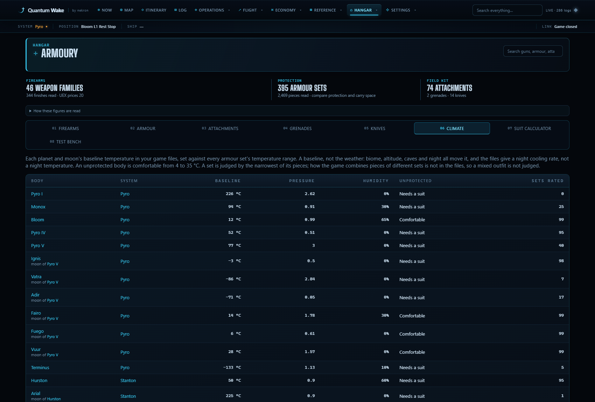

# Armoury: guns and armour, read from the install

The personal-armoury line, started 2026-09-16 after the 0.14 mining work.
What the install says about the guns a pilot carries and the armour they
wear, an Armoury page under Gear that compares them, and UEX's price beside
each. Everything here is read from this install (Alpha 4.10, `Game2.dcb`)
with `dotnet run --project src\Quantumwake.Cli -c Release -- --armoury`;
run that again after a patch and the tables below are what to compare
against. `--armoury=all` lists every finish under its gun and every colour
under its set.

## What prompted it

"Which rifle, what armour, where to buy it" is a question the community
answers on SPViewer and the wiki's weapon tables. The item catalogue the app
reads already names all 9,553 attachables, the Garage already prices a part
by the game's own id, and the Loadout page already keeps kits by name. What
was missing was any number about what a gun does.

## Where the numbers are

**A gun's damage is not on the gun.** `SCItemWeaponComponentParams` names
the magazine the gun ships with (`ammoContainerRecord`); the magazine's
`SAmmoContainerComponentParams` names an `AmmoParams` record
(`ammoParamsRecord`, and `secondaryAmmoParamsRecord` for a gun with two
loads); and that record carries the projectile - `speed`, `lifetime`, a
`DamageInfo` per hit under `projectileParams.damage` in six kinds (physical,
energy, distortion, thermal, biochemical, stun), a `damageDropParams` block
(the metres before the fall starts, the loss per metre, the floor), and for a
launcher a `detonationParams.explosionParams` block with the blast's damage
and radii. The gun keeps the fire modes.

First read of this install, 2026-09-16 - the P4-AR's line is the one the
community tables print, which is what says the chain is being followed
rather than guessed:

| Gun | Read |
| --- | --- |
| P4-AR | 12 physical, 810 rpm auto and semi, 40 rounds, drop from 40 m at 0.05/m to a floor of 10 |
| P6-LR | 100 physical, 55 rpm, 8 rounds, drop from 550 m |
| S-38 | 22.5 physical, 450 rpm, 20 rounds |
| Gallant | 21 energy, 3-round burst at 900 with 0.25 s between, 45 rounds, no drop |
| Karna | 17.5 energy, 600 rpm auto; a charge ×6 after 2 s costing 3 rounds |
| Quartz | a beam, 225 energy + 50 distortion a second to 10 m and none past 25, 7.5 rounds a second from 45 |

The magazine count has a check the reader never uses: the magazine's own
description text, written by hand - "Capacity: 40 ... holds fourty 5.56mm
cartridges" on `behr_rifle_ballistic_01_mag` - agrees with `maxAmmoCount`.

**The fire modes are a small zoo of structs.** Rapid (auto), Single (semi),
Burst (`shotCount`, `fireRate`, `cooldownTime`), Charged (`chargeTime` and a
`maxChargeModifier` with `damageMultiplier`, `ammoCostMultiplier` and
`pellets`) and Beam (`damagePerSecond`, `fullDamageRange`, `zeroDamageRange`,
`maxEnergyDraw` a second) are the leaves. Three wrappers sit over them:

- **Sequence**, with `sequenceEntries` each holding a leaf, a `delay` in
  seconds or RPM and `repetitions`, and a `mode`: *Looping* cycles them while
  the trigger is held (the Killshot's two barrels alternating at 535 a
  minute, the Lumin V's three-round bursts with a 625-rpm pause between),
  *Automatically* sends every entry on one pull (the Scalpel's two barrels
  together - a two-round burst), *Individually* one entry a pull (the
  Scalpel's semi at 60).
- **Parallel** fires every `weaponActions` entry at once: the Tripledown's
  three barrels of three pellets are one nine-pellet shot costing three
  rounds.
- **DynamicCondition** picks by state: the Parallax and the Prism turn into a
  beam and a slug when `SWeaponConditionHeatLevel` reads 40% or more.

`GameArmoury.Modes` flattens each wrapper to what the trigger does, keeping
the leaf's cyclic rate and folding a loop's delay into the burst's cooldown,
so the page compares a rifle to a rifle without knowing the tree. A mode
whose launcher says `projectileType: Secondary` fires the magazine's second
load and carries that load's damage - the Arlington's eight-pellet spread is
12.5 a pellet where its slug is 80.

**The HUD's word for a mode** is `localisedName` - `@FireMode_Rapid` is
`[AUTO]` - and the files' own `name` says more where the HUD would not:
the Prism's slug and its spread are both SEMI on the HUD and *SEMI slug* and
*SEMI* here.

**Finishes.** 327 personal weapons on this install are 46 guns and 281
finishes of them: `behr_rifle_ballistic_01_black01` is the P4-AR in black,
same figures, its own price. A finish is the gun whose class it extends, and
where the class does not extend it - the Yubarev "Deadeye" is
`lbco_pistol_energy_cen01` beside `lbco_pistol_energy_01` - the name without
its quoted word and the same figures say so. UEX files a gun under whichever
of its classes it met first (its P4-AR is
`behr_rifle_ballistic_01_contestedzonereward`), so the plain gun's price is
the cheapest across every class the game names the same.

**What is left out** of the gun table, by the sub-type the catalogue already
carries: the gadgets (multi-tool, medical gun, tractor beam, extinguisher -
tools, not weapons), and anything under `/dev/`, a template, a test rig or a
toy. Knives and grenades have their own tab (below). The Animus missile
launcher is kept with what the files give it: a blast and a magazine that
holds zero, which the page prints as a dash rather than a number.

## Knives, grenades, attachments

The three the first read left out, on their own Armoury tabs since 0.14.17.
Read on this install 2026-09-17; `--armoury` prints all three under the guns.

**Every knife is the same knife.** A knife's `SMeleeWeaponComponentParams`
points at a `MeleeCombatConfig` record, and its `attackCategoryParams` array
carries one `AttackCategoryParams` per category - `BladeSlash`, `BladeStab` -
each with an inline `DamageInfo` and an `attackImpulse`. 23 of the 26 named
knives point at `KnifeMeleeCombat`: 30 physical a slash, 30 a stab, impulse
20, 1 kg. The other three are the `_gungame` variants of the FSK-8, on
`KnifeMeleeCombat_GunGame`. So the Sawtooth, the Demon Fang, the VCK-1 and
the five Banu knives differ in look, maker and price and in nothing the files
put a number on, and the page says that once above the table rather than
printing 30 down a column. 13 plain knives, 13 finishes.

**A grenade is a trigger and a behaviour.** `EntityComponentTriggerableDevicesParams`
carries `triggers`, each a struct that says what sets it off -
`STriggerableDevicesTriggerTimerParams` with a `duration`,
`STriggerableDevicesTriggerImpactParams` - with a `behavior` pointer to what
happens: `STriggerableDevicesBehaviorExplosionParams` holds an inline
`ExplosionParams` (`damage`, `minRadius`, `maxRadius`, `pressure`), and
`STriggerableDevicesBehaviorSpawnEntityParams` names an entity to spawn. Two
grenades on this install:

| Grenade | Sets off | Blast | Leaves |
| --- | --- | --- | --- |
| MK-4 Frag | 5 s timer | 120 physical, full to 4 m, none past 5.5 m, pressure 280 | nothing |
| Scorch Plasma | impact | 2 thermal, pressure 5 - a fuse, not a weapon | `HazardZone_ksar_gren_frag_01`: `HazardComponentParams` doing 10 thermal every 0.4 s within a 4.25 m sphere |

How long the plasma patch burns is in the zone's state machine, not a
number, and is not shown. The thirteen glowsticks and the Medivac flare are
filed under `Grenade` too, carry no triggers, and are not listed.
`SPrimeableComponentParams` on a grenade holds animation states and prime-on
flags, no time.

**An attachment is a block of multipliers.** Every sight, barrel piece and
underbarrel piece under `weapon_modifier/` carries
`SWeaponModifierComponentParams`, whose `modifier.weaponStats` is an
`SWeaponStats`: `damageMultiplier`, `fireRateMultiplier`,
`soundRadiusMultiplier`, `heatGenerationMultiplier`, `ammoCostMultiplier`,
`chargeTimeMultiplier`, `projectileSpeedMultiplier`, `pellets` and
`burstShots` added, and three inline blocks - `spreadModifier` (the cone at
rest and firing, the same factor on every piece here), `recoilModifier`
(a dozen multipliers; the strength and the time are the two shown) and
`aimModifier` (`zoomScale`, `secondZoomScale`, `zoomTimeScale`). Beside
the block, `zeroingParams` gives a scope its `maxRange` and
`rangeIncrement`. 96 pieces, 73 plain: 29 barrels, 35 sights, 9 underbarrel.
The first read, for checking after a patch:

| Piece | Reads |
| --- | --- |
| Tacit Suppressor1 | damage ×0.92, sound ×0.66 (Suppressor2 and 3: sound ×0.4) |
| Stoic Suppressor1 | spread ×1.2, recoil time ×0.8, sound ×0.66 |
| Quell Suppressor1 | rate ×0.95, sound ×0.66, heat ×1.1 |
| Stark Compensator1 | damage ×1.175, rate ×0.8, recoil time ×1.1 |
| Sion Compensator1 | recoil ×0.7, sound ×1.2 |
| Escalate Stabilizer1 | damage ×0.9, rate ×1.3, +1 burst shot |
| Escalate Stabilizer3 | damage ×1.1, ammo ×2, charge time ×0.5 |
| Torrent Compensator3 | spread ×0.77, recoil ×0.7, sound ×1.2, 3 pellets fewer |
| Veil Flash Hider | recoil ×0.85 |
| EE04 (4x Telescopic) | zoom ×4 and ×6, zero to 500 m by 100, aim-down time ×1.25 |
| HG-2 Jaeger (2x Holographic) | zoom ×2 and ×4, aim-down time ×1.05 |
| Omarof (16x Telescopic) | zoom ×16, zero to 2,000 m by 200, aim-down time ×0.75 |
| 250-E Laser Pointer | spread ×0.885 |
| FieldLite Flashlight | nothing the files put a number on, and the row says so |

Two things the names do not say. A barrel's block writes `zoomScale` 1,
which means nothing and is not shown; only a sight magnifies. And the file's
zoom is not always the name's: the TS-25 Basara "(2.5x)" reads `zoomScale`
2 and `secondZoomScale` 5, the FarSight "(8x)" reads 4 and 8, the Theta Pro
"(8x)" 6 and 10. The page shows the file.

**Finishes** follow the gun rule with one more condition: a finish extends
the plain class *and* is named as it, quoted word aside. Without the name,
`arma_barrel_stab_s1_02` reads as a finish of `arma_barrel_stab_s1` - and it
is the Escalate beside the Emod, a different barrel with different figures.

## Armour

**Resistance is by class, not by piece.** Every `SCItemSuitArmorParams`
points at one of twelve `DamageResistanceMacro` records, and every piece of
a class points at the same one:

| Macro | Pieces | Physical / energy / distortion / thermal / biochemical | Stun | Impact |
| --- | --- | --- | --- | --- |
| LightArmor | 769 | ×0.8 | ×0.7 | ×0.9 |
| MediumArmor | 559 | ×0.7 | ×0.55 | ×0.6925 |
| HeavyArmor | 558 | ×0.6 | ×0.4 | ×0.65 |
| UndersuitArmor | 235 | ×0.95 | ×0.9 | ×1 |
| CombatFlightsuitArmor | 40 | ×0.85 | ×0.8 | ×0.9 |
| HeavyArmorUtility | 48 | ×0.75 | ×0.4 | ×0.65 |
| SuperHeavyArmor | 7 | ×0.125 / ×0.225 | ×0.125 | ×0.125 |

So a column of resistances would be a column of identical figures, and the
page says the rule once above the table instead. What differs between two
pieces of a class is the rest of `SCItemClothingParams` and the container:

- `TemperatureResistance.MinResistance` / `MaxResistance` - the Testudo core
  is -50 to 80 °C, the ADP -75 to 105, the Carnifex -5 to 38.
- `RadiationResistance.MaximumRadiationCapacity` and
  `RadiationDissipationRate` - 26,400 and 145.8/s on a medium core, 15,200
  and 81/s on an undersuit.
- `Flight.gForceResistance` - +0.9 on an undersuit, -0.5 on a heavy core.
- `SCItemInventoryContainerComponentParams.containerParams` →
  `InventoryContainer.*.inventoryType.capacity.microSCU` - a heavy core's
  pockets hold 8,000 to 12,000 microSCU, a Novikov backpack 180,000.
- `signatureParams` - electromagnetic 2 on a light piece, 6 on a medium, 20
  to 30 on a heavy; a helmet adds infrared.
- `restrictedMoveViewPenalty` → `MoveViewRestrictionPenalty.*` - 0.5 on
  medium, 1 on heavy, 0 on light. The game's own figure; what puts a piece
  into its restricted state is not read, and the page says so.
- `SEntityPhysicsControllerParams.PhysType.Mass`.

**Sets.** 2,349 named pieces are 384 sets-and-figures: a set is the words
before the slot word ("Testudo Core Deathblow" is Testudo), and the row is
one set, one slot, one set of figures, with the colours under it and the
cheapest of their prices beside it. A set whose figures changed between two
editions - the Morozov-SH at -90 and at -95 - is two rows, which is the
truth.

**Left out**: invisible stand-ins (`nodraw_`, `volume_`), placeholders
("TEST STRING NAME"), the NPC-only resistance macro (`_ai_exclusive`), and
anything the game has not named, which is what a shop cannot sell.

## Derived figures, and whose they are

None of these is the game's; each is the files' numbers combined the
obvious way, in `Armoury` (Core) so the tests can pin the rule:

- **Sustained rate**: the cyclic rate for auto; the cap for semi; for a
  burst, its shots over the burst's gaps and the cooldown after it (the
  Gallant's three at 900 with 0.25 s between is 470 a minute); for a charge,
  one full charge after another.
- **Damage a second**: one pull's damage - the hit, every pellet, a full
  charge's multiplier - times the sustained rate; a beam's own figure.
- **Per magazine** and **empties in**: the rounds a pull costs, a charge's
  multiplier included, into the magazine.
- **Drop**: a straight line from the start to the floor.

The page says so in the sentence under the table, and the CLI prints the
same figures so a drift shows.

## Prices

The way the Mining page prices a head: the game's own id for the class
(`GameCommodities.ItemUuid`) into UEX's item feed, cheapest terminal and
where. On 16 Sep 2026 UEX prices 20 of the 46 guns and 126 of the 384 sets.
A blank is "no terminal recorded", not free; with UEX off the column says
what it needs.

## Pictures

The game files hold no photograph of a gun or a piece of armour: a gun's
`EntityUIDisplayParams.displayIcon` is a 64-pixel Star Marine loadout glyph
(`ui/textures/ea/loadouticons/behring_p4_ar_rifle_64.tif`) and every piece
of armour points at one generic icon for its class (`medium_armour_64.tif`).
The picture in an open row is the Star Citizen Wiki's, fetched through the
same `PartPictures` the Garage bench uses - the wiki's item API by the
game's uuid, once, kept under `community/part-pictures/`, a miss remembered
for a month - behind `GET /api/armoury/picture/{uuid}`, which answers only
for an id the Armoury lists and only once the community dataset is on, the
app's consent to talk to the network. Probed 2026-09-16: the P4-AR is a
1920×1080 in-game shot served as a 600-px thumbnail (41 KB), the Testudo
core a 522×612 render (533 KB). Every finish and every colour has its own
uuid, so the chips under a row swap the picture to that one.

**Attachments are the exception, and come from the install.** Probed
2026-09-17 for anything better than the glyph:
`Data\UI\Textures\PlayerUI\WeaponAttachment\Icons\` holds 40 DXT5 icons at
512 square, named by class - every plain `arma_barrel_*` (supp, comp, stab,
flhd, sizes 1-3), the Behring/NV-TAC/Gemini/Klaus & Werner/Kastak/lbco
sights, four underbarrel pieces and the multi-tool heads - so 35 of the 73
plain attachments have one and their finishes wear it
(`WeaponAttachment.Icon`, stamped from the archive listing in the load pass
by `GameArmoury.StampIcons`). The Vera/Torrent/Stark/Escalate/Quell/Stoic
variants have no file of their own and get none rather than a neighbour's.
Decoded and cropped by the ship-icon path, cached under `attachment-icons/`,
served first by the same endpoint and without the community dataset, since
it is the pilot's own file. The rest of the archive was looked at so nobody
looks again: `Visor_HUD\assets\TIF\` has 18 renders under old class names
(`behr_rifle_ballistic_01`, `behr_frag_grenade_01`; seven guns in all),
`mobiGlas\assets\TIF\CubbyBlast_items\` 17 hand-named shop adverts, and
there is no picture of a knife anywhere - the inventory draws its thumbnails
from the models at run time. Guns, armour, knives and grenades stay the
wiki's.

## Storage, API

Read in the same pass as the rest of the game data (`GameArmoury.Read`,
cached in `commodities.json` under `Armoury`; `CacheVersion` moved).
`GET /api/armoury` returns the plain guns with their modes and derived
figures, their finishes with prices, the armour rows, and since 0.14.17 the
plain knives (`melee`, with `meleeConfigs` counting the tables they read
from), grenades (`throwables`) and attachments, each with its finishes and
the cheapest price across them. Nothing stored in a session changes: no
parser, no `PayloadVersion`.

The resolver behind "cheapest at" is taken once per request: `LogLibrary.
Terminals` rebuilds from the atlas on every read, and three thousand pieces
each asking for it took the first version of this endpoint thirty seconds.

## Fitting attachments (0.20.57)

An opened gun has a picker per attachment slot, and the gun's figures with
the picks on it beside the bare ones. Read on this install 2026-11-02 with
`--armoury=ports` (add `--data <copy>` so the re-read lands in a copy).

**What goes where is the files' rule, not a guess from names.** A gun's
`SItemPortContainerComponentParams.Ports` holds an `SItemPortDef` per slot:
`Types[].SubTypes` says which slot it is (`IronSight`, `Barrel`,
`BottomAttachment`; the magazine port is left out), `MinSize`/`MaxSize` the
sizes it takes, and `RequiredPortTags` the tags an attachment must carry.
The attachment's own `SAttachableComponentParams.AttachDef` gives its size
and `Tags`. `Armoury.Fits` checks all of it, and the attachment's
`RequiredTags` against the port's `PortTags`, which no piece on this install
uses.

- 41 of the 46 plain guns have slots, 105 in all: a sight slot on 41, an
  underbarrel slot on 40, a barrel slot on 24. The Animus and Boomtube
  launchers, the Scourge railgun, the Vendetta HMG and the Deadrig shotgun
  have none, and the page says so.
- The tags split the barrels by ammunition. Stabilisers carry only
  `energy_attach`, compensators only `ballistic_attach`, suppressors and
  flash hiders both. The P4-AR's barrel port asks for
  `FPS_Barrel ballistic_attach` at size 2, so 8 barrel pieces fit it; an
  energy gun's port takes 6.
- Sight ports run 1–1, 1–2 or 1–3, taking 19, 26 or 35 plain sights.
  Every underbarrel piece is size 1 and fits every underbarrel slot (9).
- Every one of the 73 plain attachments fits some gun.
- Six guns ship with a sight on, in their `SEntityComponentDefaultLoadoutParams`:
  the A03 (OT8-RF), Arrowhead (Touchstone), Atzkav (Omarof), P6-LR (EE08),
  Scalpel (Black Prism) and Zenith (FarSight). The picker opens with that
  sight chosen. No gun ships with a barrel or underbarrel piece, and no slot
  carries the `uneditable` flag.

**The arithmetic** (`Armoury.Combine`, `Armoury.Fitted`): the pieces'
multipliers are multiplied together and applied to the hit (and a beam's
damage a second), the cyclic rate, the rounds a shot costs, the charge time,
the heat and the projectile speed; pellets and burst shots are added, and a
shot never falls below one pellet. The derived figures then follow from the
same functions as the bare gun's. The P4-AR with a Tacit Suppressor2 reads
11.04 a hit, 162 → 149.04 a second and 480 → 441.6 a magazine.

Two things are assumed, and the page says both. Two pieces moving one
figure are multiplied: in practice only the spread, where a Stoic
Suppressor1's ×1.2 and a laser's ×0.885 meet. And the damage drop is left as
written, since whether a damage multiplier also lifts the drop's floor is not
in the files, so the fitted gun is compared at the muzzle. The rest of the
block (spread, recoil, sound, zoom, aim-down time, zeroing) does not move
these figures and is listed under them as handling.

`GET /api/armoury` gives each gun its `ports` (slot, sizes, the plain pieces
that fit, the shipped one). `GET /api/armoury/fit?gun=<class>&with=<a,b>`
returns the fitted modes in the shape the bare ones come in, and refuses a
piece that does not fit or a second piece for one slot.

**From a kit.** `GET /api/kits/guns` matches a saved kit's item names against
the install's (a finish's name finds its plain gun) and gives each kit's
attachments to the first gun in it with a free slot that takes them. The
Loadout page's kit row then has a button per gun that opens it on the
Armoury with those pieces fitted, clearing the gun filters on the way.

## Attachment test bench

The Armoury's **Test bench** tab shares attachment choices with each gun's
expanded row. **Test this fit** opens the bench on that gun. Its pickers use
the same server-provided port compatibility and fixed/default pieces; the
existing `/api/armoury/fit` endpoint supplies the combined effects and derived
mode figures. Factory fit restores the port defaults.

The target is a relative illustration. Both layers use the same repeatable
sample points in a unit disc, with the fitted layer scaled by the returned
spread multiplier. Changing pieces retains the sample; **New sample** replaces
both layers together. It does not model shot distribution, stance, distance,
recoil, or hit probability. Beam modes have no scatter plot. The base gun's
spread angle and recoil path are not extracted, so the target has no physical
distance scale and the handling indices cannot rank different weapons.

The firing figures are the endpoint's derived values at the muzzle, beside
the same mode's bare values. These inherit the fitting caveats above. No
saved kits or game data are changed by using the bench.

## Next

- How long the plasma patch burns, from the hazard zone's state machine.
- A gun or a set from this page into a kit on the Loadout page. The other
  way round is built: a kit opens its gun here.
- Whether the game multiplies two pieces' multipliers on one figure, and
  whether a damage multiplier lifts the drop's floor: an in-game check with
  a suppressor and a laser on, against a target at range.

## Climate: which suit copes where (0.20.41)

Measured on 4.10.2; `dotnet run --project src\Quantumwake.Cli -c Release -- --climate --data <scratch folder>`
reprints all of it.

**Bodies.** Each planet and moon has an `AtmosphereStateTemplate` named for
it (`Stanton1b`). Its `state` overrides temperature in kelvin, pressure and
humidity. There are 67 templates, and 28 of them are a body: Stanton's 16 and
Pyro's 12. The rest are gas clouds, asteroid fields, two prison rooms, a helmet
and vacuum. Names come from the star map (`StarMapObject.Pyro5a` is "Ignis"),
and from the app's table where a record has none, as Daymar's does.

**It is a baseline.** `PlanetDayNightTemperatureTemplate` holds only cooling
rates per profile: Earth-like -2.5, moon-like -16, Venus-like -0.1. It gives no
night temperature. Biome, altitude and caves are not in these records at all.
Daymar's baseline reads 160 °C, which no one at Shubin's pads would call
noon. Every place the page shows a baseline, it says so.

**The body.** `ActorEnvironmentComponent.temperatureParams`: an unprotected
body is comfortable from 4 to 35 °C, and the visor is fully frosted at a
suit temperature of -20 °C.

**A suit.** Every piece of a set carries the same `TemperatureResistance`
range. Every Testudo piece reads -50 to 80 °C; Novikov's exploration suit and
its helmet are -225 to 75; Pembroke's are -75 to 225. So a set is judged by
the narrowest of its worn pieces. How the game combines pieces of *different*
sets is not in the files, and a mixed outfit is not judged.

A set counts only when it covers the body, with a core or an undersuit. On
Euterpe half of what the install rates is a helmet alone. A suit's helmet and
its undersuit are named as two families ("Novikov", "Novikov Exploration"),
and nothing in the files pairs them. That leaves 99 sets that cover the body,
and 79 families of helmets, arms or legs alone.

| Body | Baseline | Sets rated |
|---|---|---|
| Aberdeen | 249.8 °C | 0 |
| Pyro I | 225.8 °C | 0 |
| Arial | 225.0 °C | 1 (Pembroke Exploration, to exactly 225) |
| Daymar | 159.9 °C | 3 (Stirling Exploration, Stirling Hazard, Pembroke Exploration) |
| Terminus | -133.1 °C | 5 (the Stirling and Novikov exploration suits) |
| Vatra | -86.0 °C | 7 |
| Euterpe | -73.1 °C | 16 |
| Bloom, Fairo, Fuego, Vuur, Ita, Cellin, ArcCorp | 6 to 30 °C | all 99; unprotected is comfortable |

The hottest-rated set reaches 225 °C and the coldest -225 °C, so no suit in
the install is rated for the baselines of Aberdeen or Pyro I.

Not yet checked against anything outside the files: a screenshot of the
helmet's temperature readout on a body would say how far the ground sits from
its baseline.
