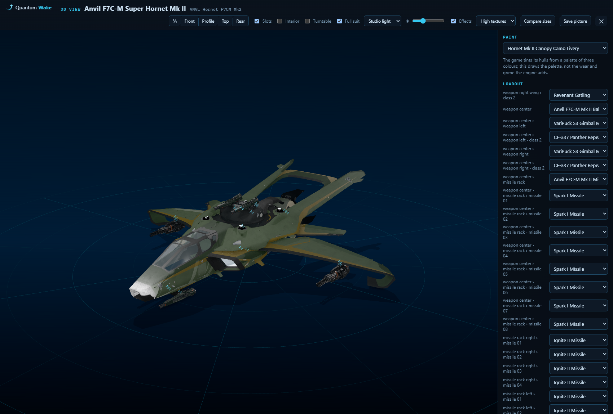
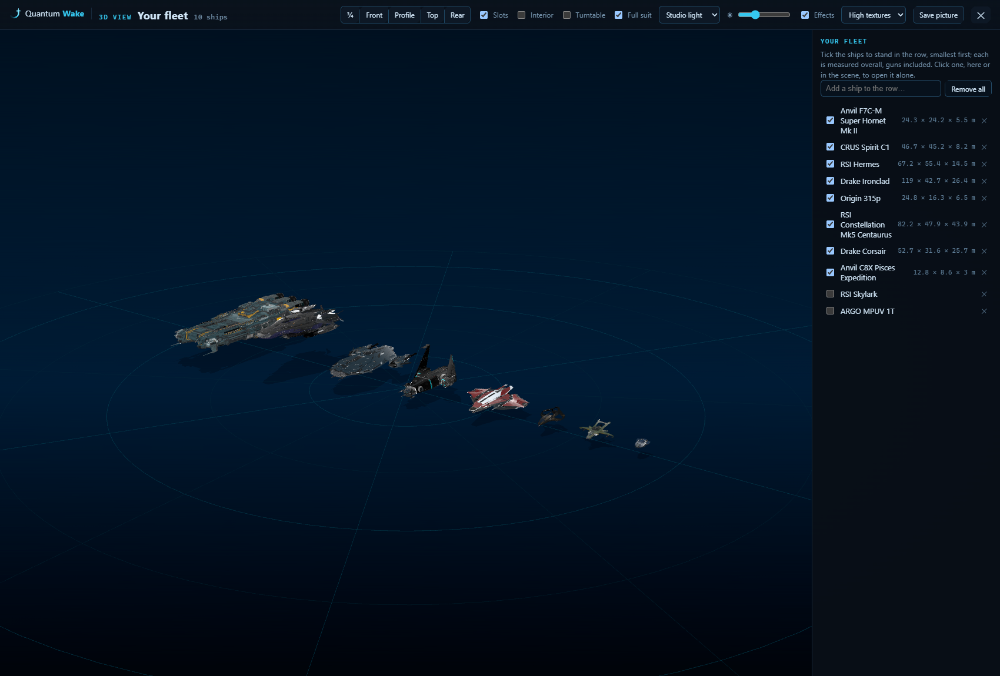
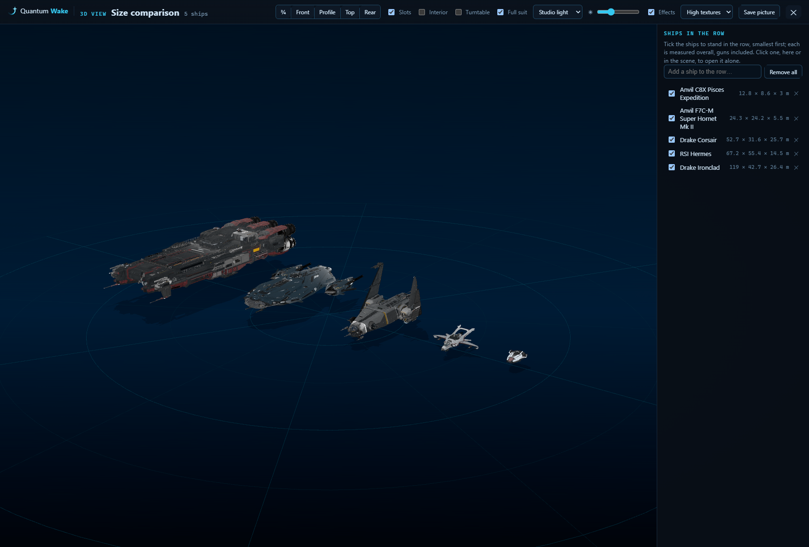
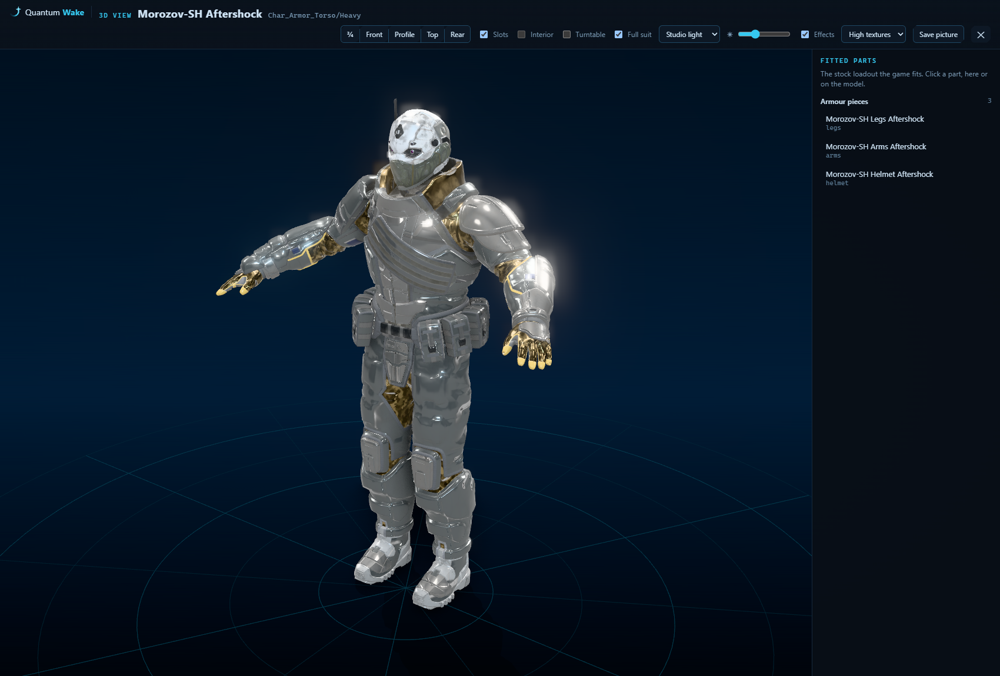
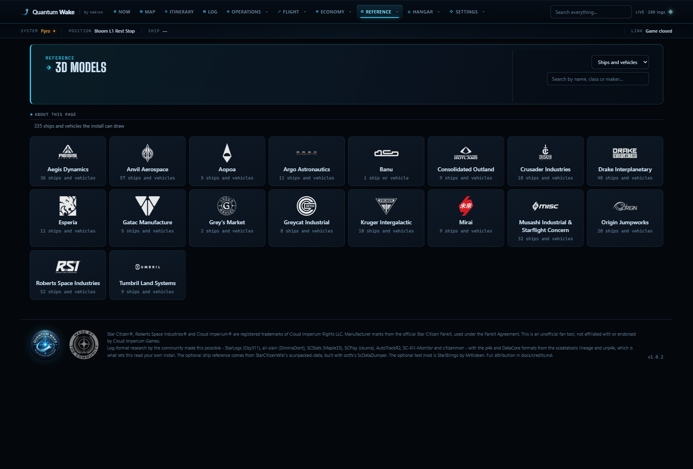

# The 3D view — ships, vehicles, weapons and armour from the install's own models

Built for 0.21.0 to 0.21.9 (2026-11-03) against 4.10.2 LIVE, build 12913470.
Everything the view draws is read out of `Data.p4k` on this machine; nothing
is downloaded. The code is `Quantumwake.Core/GameData/GameModels.cs` (what can
be drawn), `ModelMesh.cs` (how a model is packed), `ModelMaterials.cs`, the
server's `ModelEndpoints.cs`, and `web/viewer3d.js` on three.js r170, vendored
under `web/vendor/three/`.

---

## Where a ship comes from

A ship's vehicle file - `Scripts/Entities/Vehicles/Implementations/Xml/DRAK_Corsair.xml`,
which lays its parts out - is one of the archive's encrypted entries, and the
app does not open it. It does not need to:

- the entity's `SGeometryResourceParams` names the hull model;
- the hull model carries every hardpoint as a named node with its transform -
  the Corsair's has 87;
- the entity's default loadout says what fills each port, and each item's own
  record names its model;
- turrets and racks have loadouts of their own, so a manned turret holding two
  S2 gimbals holding two guns resolves the same way, one level down.

An FPS weapon is the same chain with one twist: some ports attach at a bone
whose name is not the port's (a rifle's `magazine_attach` port hangs off its
`magAttach` bone). The catalogue keeps those as `Helpers`; a port not listed
attaches at the node of its own name, as every ship's do.

Armour opens as the whole suit. A helmet, torso, arms or legs brings the rest
of its set in the same colourway where the files have it; a Full suit box
shows the piece alone.

## What the page lists

`/api/models/list` is the hulls a pilot can fly and the personal weapons that
have a name in the game's text. The rest - NPC variants and test pieces - share
a model with a named one and are left off the list, though `/api/models/find`
will still resolve any class the log names so the Garage and the Armoury can
open their own.

## The pipeline, and what it costs

Nothing runs at start-up. The first model opened pays twice: the archive index
(about 1.4 s here) and the catalogue (2.8 s the first time, then a file under
the channel's data folder, `models\catalogue.json`). Both are kept for the
life of the server after that.

A model is packed once and kept on disk as `models\<stamp>-<version>\<sha>.qwm`,
where the stamp is the archive's write time and the version is
`ModelMesh.Version` (3 at 0.21.9), so a patch or a packer change re-packs
rather than serving a stale file. Textures are not kept: reading one out of the
archive is a ZStd inflate and a concatenation of its split mip chain, and the
browser keeps them itself.

### The packed mesh, `QWM1`

The layout `ModelMesh.cs` documents and `web/viewer3d.js` reads back:

| offset | what |
|---|---|
| 0 | `QWM1` |
| 4 | header length, 32-bit |
| 8 | the header as JSON - vertex and index counts, material files, nodes (name, parent, matrix, helper flag), subsets (node, file, sub-material, first index, count) - padded to four bytes |
| then | positions, three 32-bit floats a vertex |
| then | normals, four signed bytes a vertex (the fourth unused, so every vertex starts aligned) |
| then | texture coordinates, two floats a vertex |
| then | 32-bit indices |

What the game never draws is left out at packing time rather than on the page:
the damaged variants of every panel (the Corsair's hull carries nine `_damage`
nodes, 75,000 triangles that only show once it is shot up), physics proxies,
and sub-materials whose shader is `NoDraw`. The vertices only those used are
dropped with them. A `.cdf` is a character - a skeleton and skinned parts,
which is how the Corsair's main thrusters are built - and its parts are drawn
in their rest pose under a node named for the attachment.

### Textures

A DDS goes to the graphics card still block-compressed, read straight from its
header: legacy fourCCs `DXT1`, `DXT3`, `DXT5`, `ATI1`/`BC4U`, `ATI2`/`BC5U`, and
`DX10` headers by DXGI format (BC1 to BC7, with the sRGB variants recognised
and the signed BC4/BC5 told from the unsigned). A format the GPU does not
report support for comes back null and the material falls back to its colour,
rather than uploading something the driver would refuse. The default ceiling
is 2048 pixels across; High and Ultra in the view raise it.

## Materials, and what is approximated

The game paints a hull from a palette of three colours laid over tileable
panel textures, with a normal map and a gloss map beside each. The view draws
exactly that - panels, normals, gloss, image lighting, ambient occlusion - and
a paint is that same hull with another palette, which is why the picker lists
every livery the files hold for it (ten for the Corsair). What it does not draw
is the engine's own: wear, dirt, decal stencils and parallax. A hull looks
cleaner in the view than in game, and the page says so.

**Interior.** Each studio names the inside of a hull its own way: an `Int_`
prefix (`int_metal_c`, `Int_Decal_POM_A`), an `_INT` suffix
(`Paint_DarkGrey_INT`, `Glass_INT` on the Cutlass) or `internal_` (the frame
and piping in the Avenger, Cutlass, Constellation and Carrack hulls, and the
`Damage_Internals_` under the Avenger's panels). Matching `Int_` alone left the
Interior box with nothing to switch on most hulls; the rule now is any of
those, or `interior` anywhere. Most cockpits and cabins are not in a hull's own
files at all - the game loads them separately - so the box is greyed out, with
a note, on a model that has nothing inside to show.

## Sizes

Compare sizes stands ships in a row and measures each on the model as drawn,
guns and landing gear included, so a figure can read a little over the
brochure: the Constellation Andromeda comes out 61.6 × 26.5 × 14.3 m against
the 61 × 26 × 14 RSI gives, and the Carrack 126 m. The axes are CryEngine's -
Z up, the nose along +Y - turned to three.js's Y-up once, at the root.

## Drawing only when something changes

With effects on, a frame costs about 12 ms on this machine's RTX 5080, and
drawing one for every display refresh - as the view first did - kept up to
0.8 s of each second busy on the graphics card for a model that was not
moving. The view now draws on change only; left still, it draws nothing, which
leaves the card to the game when both are running.

## What is tested

- `Quantumwake.Tests/ModelReadingTests` - the server side: catalogue, packing,
  materials.
- `Quantumwake.WebTests/ModelViewTests` - the dashboard's side: the makers
  page, search, the hand-off of a Garage build's changed ports and an Armoury
  fit's attachments.
- `Quantumwake.WebTests/ViewerModuleTests` - the module itself, loaded headless
  with three.js stubbed to its constants: the `QWM1` unpacking against the
  layout above, DDS headers (legacy and DX10, sRGB, signed BC5, a truncated
  chain, a format the GPU refuses), and the interior rule on each studio's
  names.

What no test covers is the picture: WebGL is not in the harness. That is still
a screenshot, taken the way CLAUDE.md describes.
